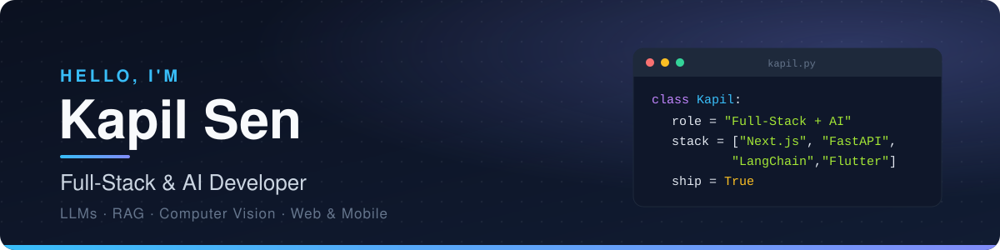

  

  
  
  

## About Me

I'm a full-stack developer who builds **AI-powered products** end to end, from LLM and RAG back ends to polished web and mobile front ends.

- Building **natural-language-to-SQL analytics** and **retrieval-augmented generation** systems
- Shipped client websites, dashboards, IoT systems, and cross-platform Flutter apps
- Exploring **agentic AI**, **reinforcement learning**, and **Web3**

## Tech Stack

**AI & Data** 

**Frontend** 

**Backend, Mobile & Web3** 

**Tools** 

## Featured Projects

<table>
<tr>
<td width="50%" valign="top">

**[SQLAnalyst AI](https://github.com/Kapil072/SqlAnalist)** · [Live demo ↗](https://sqlanalyst.vercel.app) 
Ask your databases questions in plain English and get SQL, results, and insights back. 
Python · FastAPI · Next.js · TypeScript · LLMs

</td>
<td width="50%" valign="top">

**[RAG System](https://github.com/Kapil072/Rag)** 
Modular retrieval-augmented generation pipeline with local embeddings and Grok/Groq LLM back ends. 
Python · LangChain · Hugging Face · Groq

</td>
</tr>
<tr>
<td width="50%" valign="top">

**[Gaiatryst Frequency Monitor](https://github.com/Kapil072/gaiatryst-frequency-monitor)** 
Flutter app showing live Schumann Resonance data on a rotating 3D globe, fed by a scraping + computer-vision pipeline. 
Dart · Flutter · Computer Vision

</td>
<td width="50%" valign="top">

**[Object Detector CV](https://github.com/Kapil072/Object-Detector-CV)** 
Real-time webcam object detection with YOLOv3-tiny across 80 COCO classes. 
Python · OpenCV · YOLO

</td>
</tr>
<tr>
<td width="50%" valign="top">

**[Smart Traffic Light (RL)](https://github.com/Kapil072/Traffil-Light-RL-)** 
Q-Learning agent that controls an intersection to minimize total waiting time. 
Python · Reinforcement Learning

</td>
<td width="50%" valign="top">

**[Work Wars 2.0](https://github.com/Kapil072/Work-Warss2)** 
Gamified quiz platform with AI-generated questions, badges, and progress tracking. 
React · TypeScript · Express · AI

</td>
</tr>
</table>

## GitHub Activity

  
  

  <picture>
    <source media="(prefers-color-scheme: dark)" srcset="https://raw.githubusercontent.com/Kapil072/kapil072/output/github-snake-dark.svg" />
    
  </picture>

Stats are generated daily by a GitHub Action in this repo.

## Let's Connect

  
  <!-- Add your links: replace YOUR_ID and remove the comment markers -->
  <!--  -->
  <!--  -->

